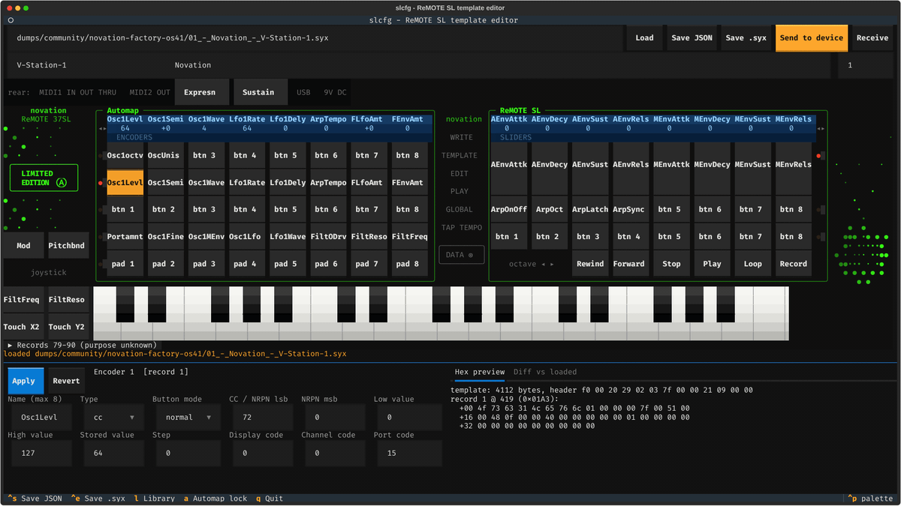

# remote-sl-config

A macOS-friendly replacement for Novation's ReMOTE SL Template Editor, for the
**ReMOTE SL Mk1** family (25/37/61 SL, the green 2008 Limited Edition 37 SL, and the keyless
ZeRO SL). Templates live as JSON, edit in a terminal UI, and travel to and from the keyboard
as SysEx.

> [!WARNING]
> **Untested on real hardware. Use at your own risk.** The ReMOTE SL template format is
> undocumented; this tool's understanding of it is reverse-engineered from public template
> files and is partly guessed (see [`docs/FORMAT.md`](docs/FORMAT.md)). Sending a template can
> overwrite what is stored on your keyboard. **Back up all 40 templates first** (Global menu →
> Template Dump → All, or `slcfg capture` step C0). The software is provided "as is", without
> warranty of any kind (see [LICENSE](LICENSE)). Not affiliated with or endorsed by Novation
> or Focusrite.



The template format is undocumented. This repo reverse-engineers it from 129 public
templates. A hardware session will confirm the rest.

## Status

| Part | State |
|---|---|
| Template framing (4112-byte message, 48-char name, slot, 90 × 41-byte control records, bulk dumps) | **confirmed** from 129 templates |
| Control order: encoders, pots, sliders, 4 button rows, pads, pedals, joystick, touchpad, transport | confirmed / likely (FORMAT §3.1) |
| Per-control name, type, CC/NRPN number, SysEx string | **confirmed** / likely |
| Low/high value, button type, step, display type, stored value | likely |
| Channel and port encoding, response / touchpad / drum Auto-Off fields, template-menu bytes, keyboard zones, records 78–89 | **guess**: kept as raw codes |
| Checksum | likely none |
| Codec | lossless: `encode(decode(x)) == x` for all 90 community files (129 templates) |
| CLI, TUI, fake MIDI port | done, tested without hardware |
| Real-device send/receive | written (`--device`), **untested on hardware: use at your own risk** |

Details and evidence: [`docs/FORMAT.md`](docs/FORMAT.md). What to capture at home:
[`docs/CAPTURE_PLAN.md`](docs/CAPTURE_PLAN.md). Judgement calls: [`docs/DECISIONS.md`](docs/DECISIONS.md).
Open questions are GitHub issues #1–#10; the hardware session is #11.

## Install

```sh
uv sync            # Python 3.12+; on Linux first: sudo apt install libasound2-dev
uv run pytest      # 240+ tests, no hardware needed
```

## Use

```sh
# look inside any dump
uv run slcfg inspect dumps/community/novation-factory-os41/01_-_Novation_-_V-Station-1.syx
uv run slcfg stride some.syx
uv run slcfg diff a.syx b.syx --view all        # raw, 7-bit-unpacked and nibblized views

# template <-> JSON (bulk dumps become one bundle file)
uv run slcfg decode my.syx -o my.json
uv run slcfg encode my.json -o my.syx

# editor: panel laid out like the 37 SL (fake loopback port unless --device is given)
# TEXTUAL_ANIMATIONS=none turns the panel animation off
uv run slcfg tui my.syx
uv run slcfg tui my.syx --device "ReMOTE SL Port 1"

# library: all 40 slots (bulk .syx, bundle .json or a folder); reorder, import/export,
# save as one bulk .syx, receive/send all. 'l' in the editor opens it too
uv run slcfg library dumps/community/novation-factory-os41/bulk/SL_Factory_Templates_OS41.syx

# hardware
uv run slcfg capture --device "ReMOTE SL Port 1"         # guided capture session
uv run slcfg capture --simulate                          # rehearse it without the SL
uv run slcfg ports
uv run slcfg receive --device "ReMOTE SL Port 1" -o dump.syx
uv run slcfg send my.json --device "ReMOTE SL Port 1"   # always asks to confirm
```

JSON layout: [`schema/template.schema.json`](schema/template.schema.json). Each control keeps
its original bytes in `_raw`. Edit the named fields; leave `_raw` alone.

## Capturing dumps from the SL

1. USB to the computer. Use the **ReMOTE SL Port 1** MIDI pair.
2. On the SL: **GLOBAL**, scroll to page 4 (Template Dump). Set **Ports** to `U1`.
3. Start `uv run slcfg receive --device "ReMOTE SL Port 1" -o dumps/captures/NAME.syx`.
4. On the SL: encoder 1 picks the template (`Current` = unsaved edit buffer, or 1–40); press
   button 1 to send it. Button 2 sends all 40.
5. `uv run slcfg diff before.syx after.syx` shows which record and field changed.

Change **one thing per control** between dumps, or let `slcfg capture` guide you. The full plan is in
[`docs/CAPTURE_PLAN.md`](docs/CAPTURE_PLAN.md).

To load a template: Memory Protect **OFF** (Global menu), `slcfg send`, then press **WRITE**
on the SL to store it.

## Layout

```
src/slcfg/
  sysex.py     framing, manufacturer IDs, 8-to-7 packing, nibbles
  diff.py      byte diffs with record/field labels
  analysis.py  ASCII runs, 8-char label finder, stride guessing
  model.py     Template/Control dataclasses, control slots, validation
  codec.py     offset table + decode()/encode()
  midi_io.py   MidiPort interface, FakeMidiPort, MidoPort, confirmed send
  capture.py   guided capture wizard: steps, annotated diffs, hypothesis checks
  simulate.py  pretend SL for rehearsing the wizard
  library.py   40-slot library: load, reorder, import/export, bulk save
  cli.py       typer CLI
  tui/app.py   Textual editor (form, previews, send/receive)
  tui/library.py library screen (40-slot table, bulk send/receive)
  tui/panel.py front panel laid out like the hardware
  tui/decor.py LCDs, LEDs, dot prints, keys (cosmetic, animated)
scripts/demo/     records docs/demo.gif (uv run python scripts/demo/record.py)
dumps/community/  public templates + sidecars (source, author, license)
docs/             FORMAT, CAPTURE_PLAN, DECISIONS
schema/           JSON Schema for template files
```

## License

Code: MIT. The files in `dumps/community/` belong to their authors (see each sidecar). They
are included unmodified for interoperability research.
